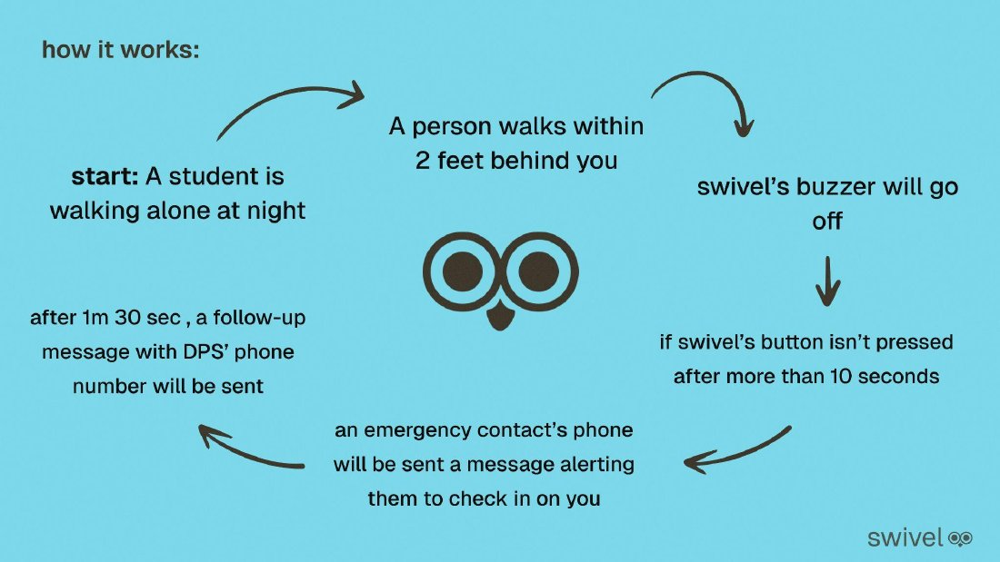
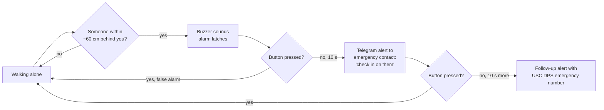
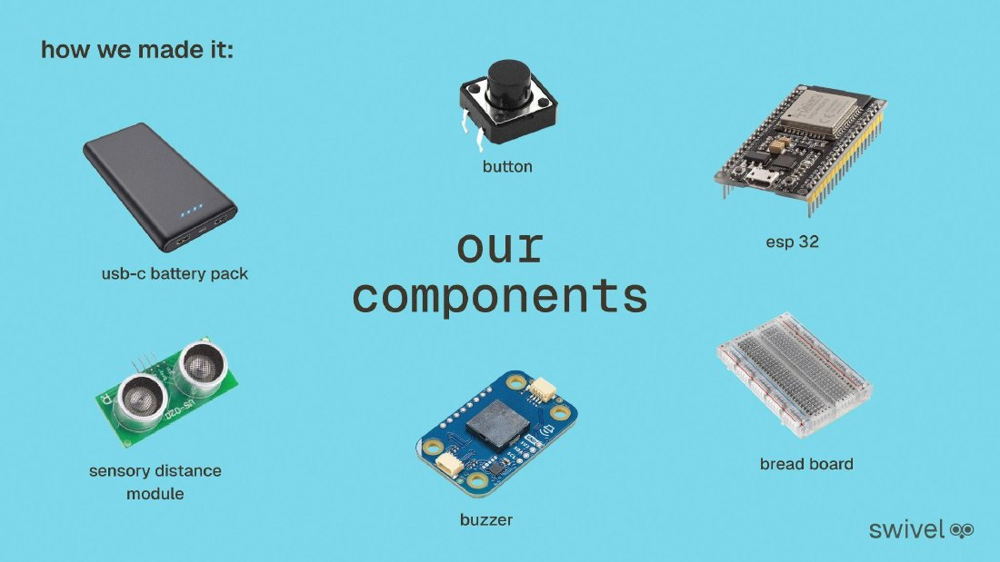
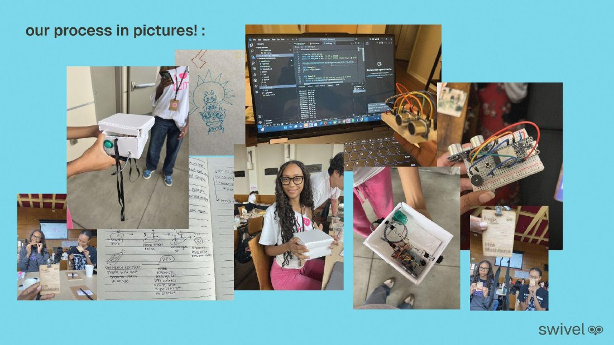

<p align="center">
  
</p>

<p align="center">
  <b>A wearable proximity alarm that watches your back so you don't have to keep your head on a swivel.</b><br>
  Built at the <a href="https://break-to-make-2025.devpost.com/">Break to Make 2025</a> makeathon at USC.
</p>

<p align="center">
  
  
  
  
</p>

<p align="center">
  <a href="https://www.youtube.com/watch?v=I2KQXFORyEo">▶ Demo video</a> ·
  <a href="https://devpost.com/software/swivel-bhvyrn">Devpost</a> ·
  <a href="docs/swivel-pitch-deck.pdf">Pitch deck (PDF)</a> ·
  <a href="https://github.com/maiankona/break2make">Original team repo</a>
</p>

---

## The problem

Female and nonbinary students at USC often don't feel safe walking alone on or near campus, especially at night. Staying on high alert is exhausting after a full day of classes, extracurriculars, and work. In the 2019 AAU Campus Climate Survey, 31% of USC undergraduates reported experiencing sexual assault during college, above the national average.

**How might we** help women and nonbinary students feel safe when walking alone near campus?

## What Swivel does

Swivel is a small, wearable device (worn on your back like a mini backpack) that senses when someone has stayed close behind you, warns you with a buzzer, and escalates to a trusted contact if you don't respond.

<p align="center">
  
</p>



## Hardware

<p align="center">
  
</p>

| Component | Purpose |
|---|---|
| Adafruit HUZZAH32 (ESP32 Feather) | Microcontroller + Wi-Fi for sending alerts |
| HC-SR04 ultrasonic range sensor | Measures distance to whoever is behind you |
| Piezo buzzer | Audible alert, driven by ESP32 LEDC PWM at 4 kHz |
| Push button | Silences the alarm and cancels alerts on a false alarm |
| USB-C battery pack | Portable power |
| Half-size breadboard + enclosure | Prototype housing with a strap to wear on your back |

### Wiring

| ESP32 pin | Connects to | Notes |
|---|---|---|
| GPIO 13 | HC-SR04 `TRIG` | |
| GPIO 34 | HC-SR04 `ECHO` | Input-only pin. Use a voltage divider if the sensor runs at 5 V. |
| GPIO 4 | Piezo (+) through 220 Ω | Piezo (−) to GND |
| GPIO 33 | Push button | Other leg to GND; uses the internal pull-up |
| 3V3 / USB, GND | Sensor power and ground | |

## Software

The firmware ([`firmware/src/main.cpp`](firmware/src/main.cpp)) runs a simple state machine:

- **Sensing:** averages 3 ultrasonic readings every loop to smooth out noise, discarding out-of-range values.
- **Latched alarm:** once someone enters the 60 cm zone, the buzzer stays on until the button is pressed, so a follower stepping back for a moment doesn't silently cancel it.
- **Staged alerts:** a timer tracks how long the alarm has been latched. At 10 s it sends a check-in message, and at 20 s it sends a follow-up with the USC Department of Public Safety emergency line.
- **Messaging:** alerts go out through the Telegram Bot API over HTTPS. The device supports both normal Wi-Fi/hotspots and WPA2-Enterprise (PEAP) campus networks.
- **Debounced button** resets the alarm and both alert stages.

All thresholds and timings are constants at the top of the file (`ALERT_CM`, `ALERT_T1`, `ALERT_T2`, `BUZZ_DUTY`).

### Build and flash

1. Install [PlatformIO](https://platformio.org/) (VS Code extension or CLI).
2. Create a Telegram bot with [@BotFather](https://t.me/BotFather), send it a message from your emergency contact's account, and grab the chat ID from `https://api.telegram.org/bot<TOKEN>/getUpdates`.
3. Copy the credentials template and fill it in:
   ```bash
   cp firmware/include/secrets.example.h firmware/include/secrets.h
   ```
   `secrets.h` is git-ignored, so your passwords and tokens stay off GitHub.
4. Build, upload, and watch the serial output:
   ```bash
   cd firmware
   pio run -t upload
   pio device monitor
   ```

## Challenges

- **Picking realistic timings.** Too short and every crowded sidewalk triggers an alert; too long and help arrives late.
- **Durability and portability.** Turning a breadboard prototype into something you can actually wear while walking.
- **Campus Wi-Fi.** USC's WPA2-Enterprise network isn't friendly to IoT devices, so we added PEAP support and a hotspot fallback.
- **Camera module.** We tried to capture a photo of the follower, but the camera system was too buggy to ship in time.

## What we learned

- Working with ESP32 pinouts and their quirks (input-only pins, ADC2 pins that stop working when Wi-Fi is on) instead of the usual ATmega328P.
- Designing around real safety scenarios and adjusting the product to fit them.
- Scoping and building an MVP in a short span of time.

## What's next

- [ ] Camera module that captures the follower and sends the photo to trusted contacts
- [ ] Danger levels by distance (e.g. high ~2 m, medium ~5 m) instead of a single threshold
- [ ] Cancel the second alert automatically when the user is no longer in danger
- [ ] Adaptive buzzer volume using a sound sensor

## Process

<p align="center">
  
</p>

## Team

Swivel was built by **Team #6** at Break to Make 2025:

| | Background |
|---|---|
| **Iriza Mushibuka** | B.S. Mechanical Engineering, USC |
| **Maia Nkonabang** ([@maiankona](https://github.com/maiankona)) | Computer Engineering, USC |
| **Halla Ibrahim** | B.F.A. Interactive Media & Game Design, USC |

This repository is my portfolio copy of our team project. The original hackathon repo lives at [maiankona/break2make](https://github.com/maiankona/break2make).

---

<sub>Statistic source: AAU Campus Climate Survey (2019), Association of American Universities.</sub>
